<!-- ===== HEADER ===== -->

  

  

  

  
  

---

## 👋 About Me

I'm **Chiraz**, a **Computer Science Bachelor's student** at **TU Braunschweig** who loves the point where logic meets design.
I enjoy building websites and web platforms with **TypeScript** and **JavaScript**, from the first idea to a working product, and I'm growing toward **frontend and software engineering**.

- 🔭 Working on: **my portfolio website**, built from scratch and hosted on GitHub Pages
- 💻 Focus: building **websites and platforms** with TypeScript & JavaScript
- 🌱 Learning next: React and modern frontend tooling
- ⚡ Fun fact: I once spent 40 minutes centering a button that was already centered. I just didn't trust it yet.

---

## 🔍 The Perfectionist in Me

I'm a perfectionist. For a long time that was a problem: I'd redo things that were already fine and struggle to call anything "finished."

Then I found frontend and software engineering, where that same instinct is useful:

- 🎨 **Pixel-level care:** I notice when a button is 2px off, when spacing is uneven or when an animation feels a little slow. Users feel those details even if they can't name them.
- ♿ **Edge cases:** small screens, slow connections, keyboard users, empty states. I want it to work for *everyone*, not only on my laptop.
- 🧹 **Clean code:** readable names, small functions, consistent structure. I refactor until the code explains itself.
- 🧪 **Testing everything twice:** I click every button, try every weird input and check every screen size, because a bug users find first is a bug I missed.

What I'm learning is that **perfect is a direction, not a finish line**. So I ship early, get feedback and keep improving in small commits. My commit history is my perfectionism, put to work. 🚀

---

## 🧰 Tech Stack

  

<b>🔍 Detailed breakdown</b>

 

| Area | Tools |
|---|---|
| **Frontend** | HTML · CSS · JavaScript · TypeScript |
| **Programming** | Java · C · C++ |
| **Tools** | Git · GitHub |
| **Learning next** | React · Tailwind CSS · data visualization |

---

## 🧪 Projects

| Project | What it is | Context |
|---|---|---|
| **Online Rommé** 🃏 | A multiplayer online Rommé card game where players can configure the game's features and rules before playing | University team project (Praktikum) at TU Braunschweig. The code is private. |
| **Portfolio Website** 🌐 | My personal site, built from scratch with HTML, CSS & TypeScript | 🛠️ In progress |

---

## 📈 GitHub Stats

  
  

  

## 📊 Contribution Graph

  

## 🐍 Contribution Snake

  

---

  <b>Got an idea, a project or a question? Let's connect! 🤝</b>

  

